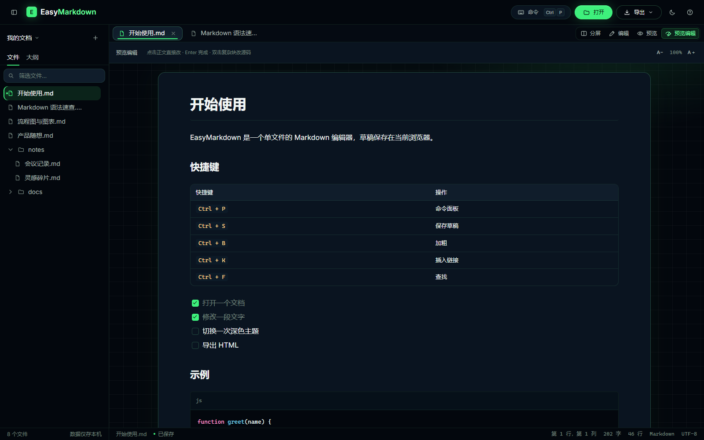

# EasyMarkdown

Windows 桌面 Markdown 编辑器。左侧树来自真实文件夹，正文直接保存为 `.md` 文件；支持实时预览、Mermaid 图表，以及像 Typora 一样在预览里直接修改。



## 下载

前往 [Releases](https://github.com/ychl758/EasyMarkdown/releases/latest) 下载最新版：

- **安装版** `EasyMarkdown-Setup-0.5.0.exe`：注册 `.md` / `.markdown` 文件关联，创建开始菜单和桌面快捷方式
- **便携版** `EasyMarkdown-0.5.0-portable.exe`：不安装，双击即用，不注册文件关联
- **单文件 HTML** `EasyMarkdown.html`：在浏览器中打开，工作区使用浏览器 localStorage

安装版和便携版都未做代码签名，首次运行可能出现 SmartScreen 提示：点「更多信息」→「仍要运行」。

安装版启动后会检查 GitHub Releases。发现新版本时，应用内会提示下载并启动安装程序；安装包会经过 SHA-512 校验。便携版会打开发布页，由你自己替换文件。

## 功能和交互

- **四种视图**：分屏、仅编辑、仅预览、预览编辑
- **预览编辑**：普通段落和标题直接在渲染结果里改；表格、代码块、Mermaid 图双击就地改 Markdown 源码
- 文件树、多标签页、新建 / 重命名 / 删除真实文件
- 自动保存；`Ctrl + S` 立即写回磁盘
- 粘贴 / 拖入图片保存到当前工作区 `assets/`，正文使用相对路径
- Mermaid 流程图 / 时序图 / 甘特图，代码块直接渲染
- 任务清单点击勾选，同步回 Markdown
- 大纲导航、命令面板、深浅主题、正文字号
- 导出 HTML（样式、图片、图表一起打包）、打印 / 另存为 PDF、下载 Markdown
- 支持 `.md` / `.markdown` / `.mdown` / `.txt`

## 真实文件夹工作区

首次启动默认使用（初始为空）：

```
%USERPROFILE%\Documents\EasyMarkdown
```

文件夹为空时显示空状态，点「新建文件」开始。点击左上角工作区名称可以切换到任意文件夹。

- 左侧树来自磁盘，不是应用内草稿
- 新建 / 重命名 / 删除都会直接操作真实文件
- 隐藏目录、`node_modules`、`assets` 不会出现在文件树
- 文件被外部修改后，用命令面板里的「刷新工作区」重新读取

## 快捷键

| 操作 | 快捷键 |
| --- | --- |
| 命令面板 | `Ctrl + P` |
| 保存到磁盘 | `Ctrl + S` |
| 加粗 / 斜体 | `Ctrl + B` / `Ctrl + I` |
| 插入链接 | `Ctrl + K` |
| 行内代码 | `Ctrl + E` |
| 编辑器内查找 | `Ctrl + F` |
| 收起 / 展开侧栏 | `Ctrl + \` |
| 关闭面板 / 弹窗 | `Esc` |

预览编辑模式下：点击正文直接改，`Enter` 完成，`Shift + Enter` 换行；双击表格 / 代码块 / 图表改源码，源码框里 `Ctrl + Enter` 完成、`Esc` 取消。

## 存储方式（没有数据库）

- **正文**：磁盘上的真实 `.md` 文件，位于你选择的工作区文件夹
- **图片**：工作区 `assets/` 目录
- **界面状态**：标签页、主题、分屏比例等保存在 `%APPDATA%\EasyMarkdown`
- **没有 MySQL / SQLite / 服务端**，不需要安装数据库
- HTML 版的数据在浏览器 localStorage，和桌面版是分开的

## 开发

需要 Node 18+ 和 Edge。

```bash
npm install
npm run build            # dist/EasyMarkdown.html
npm run electron:dev     # 本机启动桌面版
npm run dist:win         # 同时构建 NSIS 安装包 + 便携版
npm run dist:installer   # 只构建安装包
npm run dist:portable    # 只构建便携版
npm test                 # UI / 扩展 / 导入 / 预览编辑测试
npm run test:electron    # Electron 真实文件读写 + 重启记忆测试
```

国内构建 Electron 建议设置镜像：

```bash
export ELECTRON_MIRROR="https://npmmirror.com/mirrors/electron/"
export ELECTRON_BUILDER_BINARIES_MIRROR="https://npmmirror.com/mirrors/electron-builder-binaries/"
```

源码结构：

```
electron/
  main.cjs        窗口、自定义协议、文件系统 IPC、文件关联、GitHub 更新
  preload.cjs     contextBridge 暴露的桌面文件 / 更新 API
src/
  index.html      页面骨架
  styles.css      视觉样式
  app.js          交互层、预览编辑、更新提示
  editor-entry.js CodeMirror / markdown-it / 高亮 / 清洗
build.mjs         构建单文件 HTML
scripts/          UI、Electron、便携版、预览编辑、文件关联测试
DESIGN-AUDIT.md   0.3 阶段的 unslop 审计历史
```

## 技术栈

- [Electron](https://www.electronjs.org/) — Windows 桌面壳（MIT）
- [CodeMirror 6](https://codemirror.net/) — 编辑器内核（MIT）
- [markdown-it](https://github.com/markdown-it/markdown-it) — Markdown 渲染（MIT）
- [Mermaid](https://mermaid.js.org/) — 流程图 / 时序图 / 甘特图（MIT）
- [highlight.js](https://highlightjs.org/) — 代码高亮（BSD-3-Clause）
- [DOMPurify](https://github.com/cure53/DOMPurify) — HTML 清洗（Apache-2.0 / MPL-2.0）
- [Inter](https://rsms.me/inter/) — 界面字体（OFL）

单文件 HTML 约 6.3 MB；便携 exe 约 107 MB，安装包约 118 MB（主要是 Electron 运行时）。第三方许可见 [`THIRD-PARTY-NOTICES.md`](./THIRD-PARTY-NOTICES.md)。

## 已知限制

- 预览编辑以块为单位回写；列表、表格、代码、Mermaid 打开的是整块源码
- 单文件超过 2 MB 不会自动载入内容（文件树仍可见）
- 外部修改不会实时推送；使用命令面板里的「刷新工作区」
- 不支持 GBK 编码的外部文件，目前按 UTF-8 读取
- 安装版 / 便携版均未代码签名；首次运行可能触发 SmartScreen
- 安装包为 per-user 安装（不需要管理员权限）
- 没有云同步、版本历史、双链、全文搜索、多窗口

## 许可

代码以 [MIT License](./LICENSE) 开源。使用到的开源项目许可见 [`THIRD-PARTY-NOTICES.md`](./THIRD-PARTY-NOTICES.md)。
